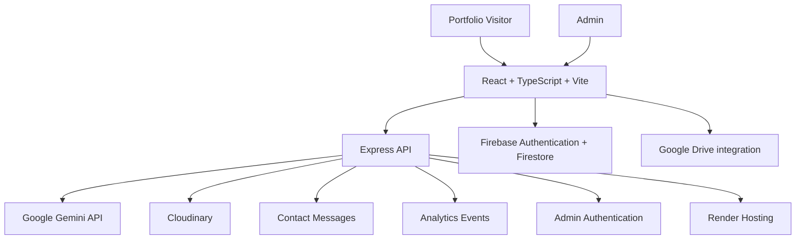

<div align="center">

# 🌍 MyWorld — Mayur H R

### A personal portfolio that goes beyond a portfolio.

<p>
  <a href="https://mayurhr.onrender.com"></a>
  <a href="https://mayurhr.onrender.com/admin/login"></a>
  <a href="https://github.com/Mayurhr/MyWorld"></a>
</p>


<p>
  <b>React · TypeScript · Vite · Express · Firebase · Cloudinary · Google Gemini</b>
</p>

<a href="https://mayurhr.onrender.com">
  
</a>


</div>

---

## ✨ About MyWorld

**MyWorld** is the next evolution of my personal portfolio. It started as a traditional static website built with HTML, CSS, and JavaScript. I redesigned and rebuilt it into a modern, full-stack portfolio experience with an AI-powered assistant, a content-management dashboard, visitor messaging, and analytics.

It is not just a place to display projects — it is a platform I can manage and evolve without manually editing website content every time.

> **Explore the live experience:** [mayurhr.onrender.com](https://mayurhr.onrender.com)

## 🚀 Explore the live application

| Area | Link | What you'll find |
|---|---|---|
| 🌐 Portfolio | [Open MyWorld](https://mayurhr.onrender.com) | Main portfolio, projects, skills, education, achievements and contact |
| 🤖 MAYU AI | [Open the portfolio](https://mayurhr.onrender.com) | Launch the MAYU AI assistant from its floating widget on the homepage |
| 🏅 Certificates | [Browse certificates](https://mayurhr.onrender.com/certificates) | Certificate collection and achievements |
| 🔐 Admin login | [Open admin login](https://mayurhr.onrender.com/admin/login) | Protected content-management access |
| 🧭 Admin dashboard | [Open dashboard](https://mayurhr.onrender.com/admin) | Manage portfolio content, messages and analytics after login |
| ❤️ Health check | [API health](https://mayurhr.onrender.com/api/health) | Backend availability endpoint |
| 💻 Source code | [GitHub repository](https://github.com/Mayurhr/MyWorld) | Project source and development history |

*Admin pages require authorized login. Open MAYU AI from its assistant widget on the portfolio homepage.*

## 🌟 Highlights

### 🤖 MAYU AI — Your portfolio companion

- AI chatbot integrated into the portfolio experience.
- Powered by the Google Gemini API.
- Answers questions about my background, education, technical skills, projects, certificates and achievements.
- Uses portfolio information as context to provide relevant, grounded responses.
- Helps visitors and recruiters explore the portfolio conversationally.

### 🛠️ Admin panel / mini CMS

A protected dashboard makes it possible to update portfolio content without repeatedly changing frontend source files.

- **Overview:** Quick view of portfolio administration.
- **Projects:** Add, edit, organize, publish and unpublish projects.
- **Certificates:** Manage certificates and achievement records.
- **Qualifications:** Update education and qualification details.
- **Skills:** Maintain skill categories and individual skills.
- **Profile:** Update profile information and public details.
- **Resume:** Manage the resume and its versions.
- **Media manager:** Organize portfolio media and uploads.
- **Connect:** Manage social and contact links.
- **Account settings:** Manage admin account credentials.

### 💬 Visitor messages

- Contact form for portfolio visitors.
- View submitted messages inside the admin dashboard.
- Read/unread message status.
- Message management from one place.

### 📊 Privacy-aware analytics

The analytics dashboard is designed to help understand how visitors use the portfolio.

- Visits, sessions and page views.
- Anonymous visitor and session identifiers.
- Section and project interactions.
- Resume and contact interactions.
- Engagement time.
- Device categories and referrer summaries.
- Date-range filters and test-event controls.

Analytics use first-party anonymous identifiers; they are not intended to identify individual visitors.

### ☁️ Media and content management

- Cloudinary integration for media uploads and delivery.
- Firebase Authentication and Firestore integration for authorized cloud content workflows.
- Google Drive integration for supported media selection and existing assets.
- Draft and published content workflows.
- Reorderable portfolio content.

### 🎨 Portfolio experience

- Responsive layouts for desktop, tablet and mobile.
- Animated interface elements and interactive sections.
- Dedicated certificate browsing experience.
- Project showcases and demo media.
- Resume preview and download experience.
- Contact and social links.

---

## 🆚 Evolution: Original Portfolio → MyWorld

| Original portfolio | MyWorld |
|---|---|
| Static HTML, CSS and JavaScript | React + TypeScript + Vite frontend |
| Content primarily maintained in source files and JSON | Admin-managed content workflows |
| Traditional portfolio navigation | Interactive, animated portfolio experience |
| No integrated portfolio AI assistant | MAYU AI chatbot powered by Gemini |
| Basic contact experience | Contact form with an admin message inbox |
| No central analytics dashboard | Visitor, engagement and interaction analytics |
| Manual content updates | Admin dashboard for projects, certificates, skills, profile and resume |
| Basic asset linking | Cloudinary and Google Drive media workflows |

The original project was the starting point. **MyWorld is a rebuild and expansion**, not simply a visual reskin.

## 🧰 Tech stack

<div align="center">

| Layer | Technologies |
|---|---|
| Frontend | React 18, TypeScript, React Router |
| Build tooling | Vite |
| Styling and UI | CSS3, responsive layouts, animations, Lucide React |
| Backend | Node.js, Express 5 |
| Authentication | Express sessions, bcrypt, Firebase Authentication for authorized cloud workflows |
| Database / cloud data | Firebase Firestore |
| Media | Cloudinary, Google Drive integration |
| AI | Google Gemini API |
| Analytics | Custom event tracking and analytics aggregation |
| Hosting | Render |

</div>

## 🏗️ High-level architecture



## 📁 Project structure

```text
MyWorld/
├── public/                  # Static public assets
├── assest/                  # Portfolio assets and branding
├── src/
│   ├── components/          # Portfolio UI and reusable components
│   ├── components/admin/    # Admin dashboard components
│   ├── context/             # Authentication and app context
│   ├── data/                # Bundled portfolio defaults
│   ├── hooks/               # Data and interaction hooks
│   ├── pages/               # Public and admin pages
│   ├── pages/admin/         # Admin dashboard screens
│   ├── server/              # Authentication, storage and AI services
│   ├── services/            # Firebase, portfolio, media and analytics
│   └── utils/               # Shared utilities
├── data/                    # Backend application data
├── server.ts                # Express application entry point
├── firebase-applet-config.json
├── firestore.rules
├── package.json
├── tsconfig.json
└── vite.config.ts
```

## ⚙️ Run locally

### Prerequisites

- Node.js and npm
- A Firebase project with the required Firestore database and Authentication configuration
- Cloudinary account for media features
- Google Gemini API key for MAYU AI

### 1. Clone the repository

```bash
git clone https://github.com/Mayurhr/MyWorld.git
cd MyWorld
```

### 2. Install dependencies

```bash
npm install
```

### 3. Configure environment variables

Create a `.env` file in the project root. Add the credentials for the services you enable:

```env
NODE_ENV=development

# Admin account bootstrap
ADMIN_USERNAME=your_admin_username
ADMIN_PASSWORD=your_strong_password

# Google Gemini
GEMINI_API_KEY=your_gemini_api_key

# Cloudinary
CLOUDINARY_CLOUD_NAME=your_cloud_name
CLOUDINARY_API_KEY=your_cloudinary_api_key
CLOUDINARY_API_SECRET=your_cloudinary_api_secret

# Google Picker (if using Drive Picker features)
GOOGLE_PICKER_API_KEY=your_google_picker_api_key
VITE_GOOGLE_API_KEY=your_google_picker_api_key
```

**Security:** Never commit `.env` or real API secrets. Configure production secrets in the hosting provider's environment settings. Firebase browser configuration is supplied through the project's Firebase configuration file; secure access with Firebase Authentication and Firestore Security Rules.

### 4. Start the development server

```bash
npm run dev
```

### 5. Build for production

```bash
npm run build
```

### 6. Start the production server

```bash
npm start
```

The Express server uses the hosting platform's assigned `PORT` when deployed.

## ☁️ Deployment

MyWorld is deployed on **Render** and is connected to the GitHub repository.

- **Live website:** [https://mayurhr.onrender.com](https://mayurhr.onrender.com)
- **GitHub source:** [https://github.com/Mayurhr/MyWorld](https://github.com/Mayurhr/MyWorld)
- **Hosting:** [Render](https://render.com/)

Typical Render configuration:

| Setting | Value |
|---|---|
| Runtime | Node |
| Build command | `npm install --include=dev && npm run build` |
| Start command | `npm start` |
| Environment | `NODE_ENV=production` plus required service credentials |

Configure all secrets in Render's Environment settings, not in the repository.

> **Free-hosting data note:** Render Free services use an ephemeral filesystem and can spin down after inactivity. This project currently has backend JSON-file storage for some server-managed records (including messages, analytics and admin credential persistence). Do not assume those records are durable across restarts or deploys on the free instance. Use a persistent database or durable storage before relying on those records for production. Firestore-backed portfolio workflows and Cloudinary media storage are separate services.

## 🔐 Security and privacy

- Admin routes are protected by authentication.
- Passwords are verified using bcrypt.
- Login attempts are rate-limited.
- Admin session cookies are configured as HTTP-only and secure.
- Firebase cloud writes are restricted through authorized admin identity checks and Firestore Security Rules.
- Analytics use anonymous first-party visitor/session identifiers.
- API keys and service secrets belong in environment variables, never in source control.

## 🗺️ Roadmap

- [ ] Complete durable database migration for all backend-managed records.
- [ ] Improve analytics reporting and visualization.
- [ ] Continue optimizing frontend bundle size and loading performance.
- [ ] Expand MAYU AI capabilities and portfolio interactions.
- [ ] Add further accessibility and performance refinements.

## 🤝 Feedback

Found an issue or have an idea? Please open an issue in the [GitHub repository](https://github.com/Mayurhr/MyWorld).

## 👨‍💻 About the developer

**Mayur H R** — Information Science & Engineering student and developer interested in full-stack development, AI-powered applications, and building useful digital experiences.

- 🌐 Portfolio: [mayurhr.onrender.com](https://mayurhr.onrender.com)
- 💻 GitHub: [@Mayurhr](https://github.com/Mayurhr)
- 🔗 Repository: [Mayurhr/MyWorld](https://github.com/Mayurhr/MyWorld)

---

<div align="center">

### Thanks for visiting MyWorld! ✨

**Explore. Interact. Discover.**

<a href="https://mayurhr.onrender.com">Visit the live portfolio ↗</a>

</div>
